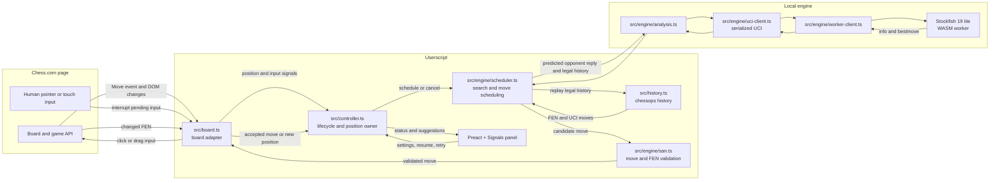

# Super Chess Bot

A GPL-3.0-or-later Tampermonkey userscript with local Stockfish analysis and confirmed move input on Chess.com. Engine strength and bullet performance depend on the device and move budget; this project does not claim a measured Elo.

## Architecture



- **Engine:** pinned Stockfish 19 lite single-threaded WASM. The worker prewarms when the panel mounts, while automation stays disabled, so download and WASM compilation happen before the first game move. One worker survives normal searches and cancellation, preserving its transposition table. The userscript manager downloads pinned JS/WASM resources from unpkg; keep this host because jsDelivr rejects the full 205 MB npm package even for its small lite files. Search is local after initialization. No main-thread search fallback.
- **Board adapter:** subscribes to the private `Move` event when available and coalesces DOM changes in a microtask. A slow recovery check handles lifecycle/board replacement. Private site APIs can change; keep these dependencies isolated.
- **Controller:** waits for engine readiness, owns the current position and search revision, rejects obsolete results, and stops pending work when disabled. Input is validated against the actual position.
- **Timing:** the configured move budget reserves input time once. There is no second post-search thinking delay. A separate bounded timeout confirms that the intended move was accepted. Browser scheduling and engine stop latency can exceed the requested budget.
- **Recovery:** trusted human board input cancels pending automation and pauses the bot. A changed position resumes analysis automatically; when the position stays the same, the panel offers Resume. Engine and unconfirmed-input failures offer Retry.
- **History:** chessops reconstructs the selected SAN line into UCI history for repetition-aware search. Incomplete history falls back to the current FEN; repetition before that FEN cannot then be inferred.
- **Ponder:** enabled by default for new settings. The chosen move's principal variation predicts one opponent reply, then Stockfish searches the resulting position with UCI `go ponder` during the opponent's turn. An exact FEN and history match promotes that search; a completed ponder result is also reused only when FEN, history, and depth all match. A miss is stopped and drained before a fresh search. At depth 12 or higher the current best move is returned immediately; shallower searches get the normal foreground budget after `ponderhit`. This spends CPU while the opponent thinks and can use more battery. The panel toggle can disable it. Pondering analyzes a predicted reply; it does not queue a premove.
- **UI:** Preact + Signals inside Shadow DOM, with Tailwind 4 compiled during the build. The panel is draggable, logs are capped at 100 entries, and stored settings are validated with Zod Mini. The bot starts disabled each time.

## Install and use

1. Install Tampermonkey in Chromium.
2. Build and install `dist/bundle.user.js`. The userscript manager also fetches the two version-pinned engine resources.
3. Open `https://www.chess.com/play/computer/Komodo20` and start a computer game.
4. Enable the bot. Wait for Stockfish to initialize. Choose auto move or analysis-only mode.
5. Start at a 100 ms budget, then tune against measured strength and latency on your device. The default depth cap is 30, letting the time budget normally end a fresh search; achieved depth varies. A matching ponder search can make the response immediate after it reaches depth 12.

Click input is the default. Drag input exists for boards that reject click input; promotion waits for the site's chooser. An unconfirmed move is not retried repeatedly against the same position. Change settings or advance the position to retry deliberately.

## Development

```sh
bun install --frozen-lockfile
bun run check
```

`bun run check` runs Biome, strict TypeScript, Knip, Vitest, and the production build. Run one step with `bun run test`, `bun run typecheck`, `bun run lint`, `bun run knip`, or `bun run build`. Biome and Knip are development tools and are not included in the userscript. Stockfish is loaded as a userscript resource, so Knip's configuration accounts for that external loading.

## Browser verification

Use `agent-browser` with a dedicated Chromium session and the production bundle installed through a userscript manager. Test board orientation, promotion, enable/disable during search, game reset, human interruption and recovery, and the position event path. Run matches only against a selected Chess.com computer opponent.

The full game verified through an installed Violentmonkey manager, including the result, move list, and recording, is documented in [browser-verification.md](docs/browser-verification.md).

The latest 1+0 minimum-budget samples, including two wins against the displayed 3200 Maximum bot, are also recorded there. A later warmed 2900 run used 36.3 seconds on our clock, compared with 13.4 seconds in an earlier run, so sub-5-second whole-game timing is not established. For strength checks, record the opponent's displayed rating, result, time control, bot move budget, plies, and our clock before and after the game. Report initialization, warmed search, and move confirmation separately. These games are observations, not a calibrated bot Elo; repeat games before making a reliability claim.

Chess.com premoves were manually verified against a computer opponent in a no-timer game. The platform executed a queued move after the bot's reply. Automatic premoves remain off: Chess.com says each one costs 0.1 seconds and plays regardless of the opponent's move, so they can create blunders and do not guarantee a lower total clock cost. See the measured test and policy notes in [browser-verification.md](docs/browser-verification.md).

## License

GPL-3.0-or-later. Stockfish's bundled engine remains GPL-3.0; its upstream source and license are available at https://github.com/nmrugg/stockfish.js. See `LICENSE`.
