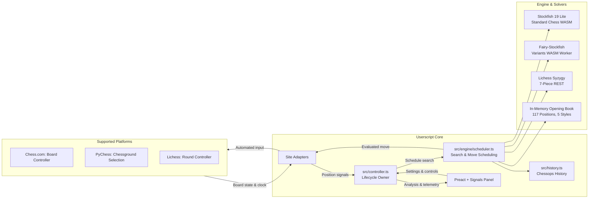

# Super Chess Bot

A GPL-3.0-or-later browser userscript featuring local Stockfish 19 lite and Fairy-Stockfish WASM analysis, asynchronous Syzygy 7-piece tablebases, and confirmed move automation on Chess.com, PyChess, and Lichess.

[](dist/bundle.user.js)
[](dist/chesscom.user.js)
[](README-c.md)
[](LICENSE)

> Looking specifically for the Chess.com edition? See the dedicated [Chess.com Guide (README-c.md)](README-c.md).

---

## Architecture



---

## Core Capabilities

- **Dual Engine Core (Stockfish 19 Lite & Fairy-Stockfish WASM)**: Runs fully client-side in a single dynamic Web Worker slot. Prewarms on panel mount. Automatically selects Stockfish 19 Lite for standard chess or Fairy-Stockfish for detected variants.
- **Full Chess Variant Support**: Autodetects and plays non-standard games without manual configuration:
  - **Lichess**: Crazyhouse, Atomic, Antichess (Giveaway), King of the Hill, Three-check, Racing Kings, Horde, and Chess960.
  - **PyChess**: Capablanca, Xiangqi, Shatranj, Seirawan, and exotic fairy games (supporting non-8x8 geometries up to 10x10 and piece drops).
  - Non-standard variants automatically bypass the standard opening book and orthodox Syzygy tablebases while routing search directly through Fairy-Stockfish UCI.
- **Asynchronous Syzygy 7-Piece Tablebases**: Non-blocking endgames solver querying Lichess Syzygy whenever $\le 7$ pieces remain in standard games. Resolves instantly (<0.01 ms cached, 160–300 ms cold network) with clock-proportional timeout protection.
- **In-Memory Opening Book**: 117 standard positions across 5 styles (Hyper-Defensive, Defensive, Balanced, Aggressive, Hyper-Aggressive) covering plies 1–8 in <0.01 ms with 0 ms engine clock drain.
- **Multi-PV Candidate Analysis**: Calculates the top 3 lines concurrently (`MultiPV = 3`) with color-coded board arrows (Green #1, Cyan #2, Amber #3) and evaluations in the panel.
- **Humanized Ex-Gaussian Timing**: Box-Muller Gaussian distribution with an entropy-scaled exponential tail. Simulates natural human hesitation in complex positions and scales down search time in forced moves.
- **Target Elo & Blunder Shield**: Boltzmann softmax move selection simulates realistic human strength tiers (1500–2800+). Blunder Shield prevents catastrophic tactical mistakes (>150 centipawn drop).
- **Scoresheet & Standard PGN Export**: Tracks live move times with visual comparison bars. Exports clean PGN with standard `[%emt]` tags recognized by Lichess and Chess.com.
- **On-Demand Game Report**: Post-game accuracy review with customizable search depth stepper (10–26) and per-player accuracy %, blunders, and ACPL based on Lichess formulas.
- **Stealth Cloaking & Ghost Mode**: Closed Shadow DOM, ephemeral `WeakSet` node tracking, and zero detectable CSS classes. Press `♟ Toggle Ghost Mode` in the userscript manager menu to hide all overlays for clean streaming.

---

## Platform Support

| Feature | Chess.com | PyChess | Lichess |
| :--- | :--- | :--- | :--- |
| **Supported Games** | Live, computer, and events | Standard chess & Fairy variants | Standard chess & 8 official variants |
| **Variants Supported** | Standard, Chess960 | Capablanca, Xiangqi, Shatranj, etc. | Crazyhouse, Atomic, Antichess, King of the Hill, 3-Check, Racing Kings, Horde, Chess960 |
| **Active Engine** | Stockfish 19 Lite | Stockfish 19 Lite / Fairy-Stockfish | Stockfish 19 Lite / Fairy-Stockfish |
| **Move Transport** | Board controller `controller.move` | Legal square selection (`selectSquare`) | Round controller `pluginMove` |
| **Promotion** | Explicit lowercase role | Chooser override (queen auto-promote) | Explicit lowercase role |
| **Ponder** | Yes | Yes | Yes |
| **Opening Book** | Yes (Standard) | Yes (Standard) | Yes (Standard) |
| **Syzygy Tablebase** | Yes (Standard) | Yes (Standard) | Yes (Standard) |
| **Multi-PV (3 lines)**| Yes | Yes | Yes |
| **Ghost Mode** | Yes | Yes | Yes |

*Note: Trusted human board interaction pauses automation automatically; a changed position resumes analysis.*

---

## Installation & Quick Start

1. Install [Violentmonkey](https://violentmonkey.github.io/) or [Tampermonkey](https://www.tampermonkey.net/) in your browser.
2. Install the desired build:
   - **Multi-Site Bundle:** [dist/bundle.user.js](dist/bundle.user.js) *(Chess.com, PyChess, Lichess with Fairy Engine)*
   - **Chess.com Only:** [dist/chesscom.user.js](dist/chesscom.user.js) *(Standard Chess only, Stockfish-only lightweight build; see [README-c.md](README-c.md))*
3. Open a supported game on any platform.
4. Wait for the panel status to display **Ready**, then click **Enable Bot**.

> **Lichess Setup:** In Violentmonkey, enable **Settings → Advanced → Synchronous `<page>` mode** and reload Lichess.

---

## Development

```sh
bun install --frozen-lockfile
bun run check
```

`bun run check` runs Biome linting, TypeScript typecheck, Knip unused-code analysis, Vitest unit tests, and production builds (`bundle.user.js` and `chesscom.user.js`).

For benchmarks and browser verification logs, see [`docs/browser-verification.md`](docs/browser-verification.md) and [`AGENTS.md`](AGENTS.md).

---

## License

GPL-3.0-or-later. Stockfish 19 lite and Fairy-Stockfish are licensed under GPL-3.0. See [LICENSE](LICENSE).

