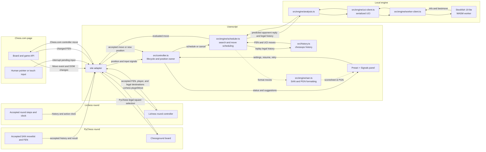

# Super Chess Bot

A GPL-3.0-or-later browser userscript with local Stockfish analysis and confirmed move input on Chess.com, PyChess, and Lichess standard games. Engine strength and bullet performance depend on the device and move budget; this project does not claim a measured Elo.

## Architecture



- **Engine:** pinned Stockfish 19 lite single-threaded WASM. The worker prewarms when the panel mounts, while automation stays disabled, so download and WASM compilation happen before the first game move. One worker survives normal searches and cancellation, preserving its transposition table. The userscript manager downloads pinned JS/WASM resources from unpkg; keep this host because jsDelivr rejects the full 205 MB npm package even for its small lite files. Search is local after initialization. No main-thread search fallback.
- **Site adapters:** exact-host adapters provide the current accepted FEN, player color, orientation, phase, clock, history, and supported controls. Chess.com captures the board controller during page initialization and submits through `controller.move` with an explicit lowercase promotion character; it does not synthesize pointer input or touch the promotion chooser DOM. PyChess reads Chessground state plus the accepted SAN movelist, and uses legal `selectSquare` user moves. Lichess captures the round controller during page initialization and uses `pluginMove`; it does not call a Lichess API or write directly to the socket. The Chess.com and Lichess hooks depend on private page internals and may need updates after frontend changes.
- **Controller:** waits for engine readiness, owns a stable game/board identity and search revision, rejects obsolete results, and stops pending work when disabled. Replay and finished positions suspend analysis. Trusted board interaction pauses automation; a changed position resumes automatically, while an unchanged position offers Resume.
- **Timing:** selectable between **Dynamic** (default) and **Fixed** modes. In Dynamic mode, single-legal-move positions scale down thinking time to ~20% of budget, opening book moves receive subtle humanized micro-delays (45–250 ms), and delay distributions follow an **Ex-Gaussian entropy model** (`src/engine/timing.ts`). The model uses Box-Muller normal sampling combined with an exponential tail scaled by Shannon entropy over candidate move centipawn scores, mimicking human hesitation in complex tactical positions. In Fixed mode, moves search for the rigid full allocated budget without complexity scaling. The configured move budget reserves input time once. PyChess and Lichess read the active player's clock from their round state; Chess.com keeps its current clock handling. Lichess move submission goes through the round controller's normal clock stop and move-send path. A separate bounded confirmation checks the accepted position at the expected ply. Browser scheduling and engine stop latency can exceed the requested budget.
- **Endgame tablebases:** asynchronous Syzygy 7-piece tablebase lookups (`src/engine/tablebase.ts`) querying `https://tablebase.lichess.ovh/standard` whenever $\le 7$ pieces remain on the board. The lookup runs concurrently with Stockfish in a non-blocking race with a clock-proportional timeout (`remainingMs / 4`). Candidate moves are evaluated with negamax outcome ranking (immediate checkmate > win minimization > stubborn loss defense) using DTZ/DTM metrics. Valid tablebase moves resolve instantly (<0.01 ms from in-memory LRU cache, 160–300 ms cold network), overriding engine search without clock flag risks.
- **Multi-PV analysis:** calculates the top 3 alternative candidate variations concurrently (`MultiPV = 3` in `src/engine/uci-client.ts`). Board overlays render distinct colored arrows for each line (Green for #1 best move, Cyan for #2 alternative, Amber #3 alternative via `src/board.ts`), and the panel displays SAN candidates and evaluations.
- **Elo throttling and blunder shield:** soft-capping engine tactical strength (`src/engine/throttle.ts`) via softmax probability distributions over top candidate lines to simulate target Elo tiers (e.g. 1500, 2000, 2400, 2800) naturally without robotic precision. Includes an active "Blunder Shield" (Co-Pilot mode) that strictly rejects moves dropping evaluation by $> 150$ centipawns.
- **Recovery:** trusted human board input cancels pending automation and pauses the bot. A changed position resumes analysis automatically; when the position stays the same, the panel offers Resume. Engine and unconfirmed-input failures offer Retry.
- **History:** chessops reconstructs the selected SAN line into UCI history for repetition-aware search. Incomplete history falls back to the current FEN; repetition before that FEN cannot then be inferred.
- **Opening book:** in-memory opening book of 117 positions covering plies 1–8 with 5 selectable styles (Hyper-Defensive, Defensive, Balanced, Aggressive, Hyper-Aggressive; zero new dependencies). Selectable via an SVG segmented bar with live descriptions. It covers the Najdorf and Dragon hubs, Caro-Kann, French (including the Winawer), Philidor, London and Colle, Nimzo-Indian, King's Indian, Benoni and Benko, the Queen's Gambit family (QGD, QGA, Slav, Semi-Slav), Ruy Lopez and Berlin, Giuoco Pianissimo, Two Knights, Scotch, the gambit lines (King's Gambit, Evans, Danish, Smith-Morra, Blackmar-Diemer, Stafford, Traxler), the English Opening, and the Reti family. Moves resolve in <0.01 ms with 0 ms engine clock drain; anything not in the book falls through to Stockfish. The panel toggle can disable it to force pure engine calculation from move 1. Positions are matched on placement, side to move, and castling rights only, because the three hosts disagree about the en passant field.
- **Move scoresheet and standard PGN export:** live game move tracking (`src/game-history.ts`, `src/pgn.ts`) records both White and Black moves with elapsed move timings. Elapsed time is computed from site clock deltas when clocks are active, falling back to wall-clock observation intervals. The Activity panel renders a paired scoresheet with zebra striping, a highlighted current move, and a right-hand time gutter whose bars scale to the longest time in the game, so a big clock swing is visible without reading the numbers. The Copy button formats the active game as standard PGN containing headers, `{ [%emt H:MM:SS.s] }` timing tags recognized by Lichess and Chess.com, and an end-of-game telemetry notice (`{ Warning: Move timings and evaluations are client-side browser telemetry estimates. } *`).
- **Post-game accuracy report:** when a round finishes, `src/report/` analyzes every recorded ply with the local engine and shows a per-player summary: headline accuracy %, inaccuracies, mistakes, blunders, and average centipawn loss (ACPL). Scores use Lichess's published formulas, so figures sit close to the big sites but are not identical, and the panel labels them a local estimate. The pass starts only once the round is no longer live, because it shares the engine worker with move search.
- **Ponder:** enabled by default for new settings. The chosen move's principal variation predicts one opponent reply, then Stockfish searches the resulting position with UCI `go ponder` during the opponent's turn. An exact FEN and history match promotes that search; a completed ponder result is also reused only when FEN, history, and depth all match. A miss is stopped and drained before a fresh search. At depth 12 or higher the current best move is returned immediately; shallower searches get the normal foreground budget after `ponderhit`. This spends CPU while the opponent thinks and can use more battery. The panel toggle can disable it. Pondering analyzes a predicted reply; it does not queue a premove.
- **UI & Telemetry:** Preact + Signals inside closed Shadow DOM (`mode: 'closed'`) with focused Hallmark workbench styles. Includes an interactive SVG `<EvalTrendGraph />` rendering centipawn momentum trajectory across plies directly in the panel, a top-level Guide modal (`?`), Auto-retry resilience toggle, and clean distraction-free controls without conflicting keyboard shortcuts. The panel is draggable on desktop, docks as a bottom-sheet on mobile (≤ 560 px), logs are capped at 100 entries, stored settings are validated with Valibot (`scb_settings`), and Userscript GM menu commands (`♟ Toggle Ghost Mode`, `♟ Toggle Bot Automation`) enable rapid, stealthy operation.
- **Stealth & Cloaking:** zero legacy signatures or detectable identifiers. Board overlays use closed Shadow DOM and ephemeral JavaScript `WeakSet` node tracking (`markBotNode`, `isBotOwnedNode`) without inserting detectable CSS classes or DOM attributes (`data-gabibot-overlay`, `data-engine-layer`). Stream-Safe Ghost Mode completely hides all board canvas overlays, eval bars, and floating controls for clean OBS/stream broadcasting. Accessible exclusively via the userscript GM menu (`♟ Toggle Ghost Mode`).

## Install and use

1. Install Tampermonkey or Violentmonkey in your browser: **Microsoft Edge**, **Firefox**, **Vivaldi**, **Helium**, **Google Chrome**, **Brave**, or mobile browsers (Firefox for Android + Violentmonkey, Safari + Userscripts, or Orion).
2. Build and install `dist/bundle.user.js` (multi-site build) or `dist/chesscom.user.js` (standalone Chess.com build). The userscript manager also fetches the two version-pinned engine resources.
3. Choose a supported game: a Chess.com game, a PyChess round, or a Lichess round.
4. On PyChess, keep **CHESS**, Chess960 off, and real-time play. For 1+0, set the minutes slider to index **4** (one minute), increment to 0, and select **White** by its title.
5. Wait for the panel and Stockfish to report `Ready`, then enable the bot. It starts disabled on each page load. Choose auto move or analysis-only mode.
6. Tune move budget against measured strength and latency on your device (slider allows 25–5000 ms in 25 ms steps; 50–100 ms is ideal for bullet). The default depth cap is 30, letting the time budget normally end a fresh search; achieved depth varies. A matching ponder search can make the response immediate after it reaches depth 12.

For Lichess in Violentmonkey, enable **Settings → Advanced → Synchronous `<page>` mode** and reload Lichess after installing or updating the script. The controller bridge must run in the page context before Lichess initializes its round.

PyChess support covers a live, owned 8×8 chess round where the signed-in or anonymous player identity matches White or Black. The adapter checks the game URL and id, player membership, variant, Chess960 setting, real-time mode, accepted six-field FEN, and legal SAN history. It submits moves through the board's legal square-selection path and waits for the server-confirmed FEN at the bot move's ply. When browsing an older move, input is suspended until the live position returns. A trusted board action pauses the bot and shows Resume when the accepted position has not changed.

Lichess support covers a live, standard chess player round. The adapter verifies the player round, accepted FEN and SAN history, side to move, and legal destinations. It sends ordinary moves and explicit promotion roles through the round controller and waits for the accepted position. The active clock is read from the same round controller; the site's move path stops it and sends the move. No API integration is used.

On PyChess the panel explains the legal square-selection transport; on Lichess and Chess.com it identifies the game-controller transport. There is no input-method setting; moves always go through the site controller or legal selection path.

Chess.com submits through the board controller with an explicit lowercase promotion character and reads success synchronously from the `Move`/`IllegalMove` result; a stuck `PomotionAreaShowing` chooser is reset through the renderer's close method. An unconfirmed move is not retried repeatedly against the same position. Change settings or advance the position to retry deliberately.

## Site support

| | Chess.com | PyChess | Lichess |
| --- | --- | --- | --- |
| Plays | any live game exposing the site board API (computer + online) | standard chess live rounds, any opponent | standard-chess player rounds, any opponent |
| Move transport | board-controller `move` | legal square selection | round-controller `pluginMove` |
| Promotion | explicit lowercase character (controller API verified; live-game confirmation pending) | chooser q/r/b/n + Ctrl override (queen verified live; underpromotion with site auto-promote on unverified) | explicit role (unit-tested; live game unverified) |
| Premove | off | off | off |
| Background ponder | yes | yes | yes |
| Opening book (plies 1–8) | yes | yes | yes |
| Syzygy 7-piece tablebase | yes | yes | yes |
| Multi-PV (top 3 lines) | yes | yes | yes |
| Ex-Gaussian entropy timing | yes | yes | yes |
| Stream-safe ghost mode | yes | yes | yes |
| Clock-aware budget | yes (page clock, else fixed budget) | yes (round clocks, else fixed budget) | yes (controller clock, else fixed budget) |
| Replay / finished | terminal reload recovery | replay suspends input until live returns | replay suspends input until live returns |

The engine only knows standard chess: non-chess variants, Chess960, and correspondence rounds stay ineligible on PyChess, and non-standard variants stay ineligible on Lichess. The bot starts disabled on every page load; trusted board input pauses it and offers Resume when the position is unchanged.

### Syzygy tablebase measured speed benchmark (2026-10-12)

Live latency measured across 10 diverse endgame positions (3 to 7 pieces) against the public Lichess Syzygy REST API (`https://tablebase.lichess.ovh/standard`):

| Test Position | Pieces | Best Move | Outcome | Eval | Network Latency |
| :--- | :---: | :---: | :---: | :---: | ---: |
| KQK | 3 | `h1d5` | win | `+M5 (Tablebase)` | 834.0 ms (cold TLS) |
| KRK | 3 | `h1h4` | win | `+M10 (Tablebase)` | 162.9 ms |
| KPK | 3 | `e2e3` | draw | `0.00 (Tablebase Draw)` | 161.6 ms |
| KQKR | 4 | `h1h6` | win | `+M23 (Tablebase)` | 262.6 ms |
| KBBK | 4 | `f1e2` | draw | `0.00 (Tablebase Draw)` | 219.4 ms |
| KBNK | 4 | `h1f2` | win | `+M31 (Tablebase)` | 164.2 ms |
| Lucena Position | 5 | `c1d1` | win | `+M21 (Tablebase)` | 172.9 ms |
| Philidor Position | 5 | `b3b2` | draw | `0.00 (Tablebase Draw)` | 238.3 ms |
| KRPKRP | 6 | `h1a1` | win | `+M13 (Tablebase)` | 214.6 ms |
| 7-piece complex | 7 | `b1d2` | win | `+M13 (Tablebase)` | 570.9 ms |

- **Summary statistics**: Min: 161.6 ms · Median (p50): 219.4 ms · Mean: 300.1 ms · p95: 834.0 ms · In-memory cache hit: <0.01 ms.
- **Race safety**: `scheduler.ts` executes tablebase lookups concurrently with Stockfish; if network exceeds the clock threshold (`remainingMs / 4`), local engine search returns immediately without stalling or flagging on time.

## Development

```sh
bun install --frozen-lockfile
bun run check
```

`bun run check` runs Biome, strict TypeScript, Knip, Vitest, and both production builds (`dist/bundle.user.js` and `dist/chesscom.user.js`). Run one step with `bun run test`, `bun run typecheck`, `bun run lint`, `bun run knip`, `bun run build:all`, `bun run build:chesscom`, or `bun run build`. Biome and Knip are development tools and are not included in the userscript. Stockfish is loaded as a userscript resource, so Knip's configuration accounts for that external loading.

## Browser verification

Use `agent-browser` with a dedicated Chromium session and the production bundle installed through a userscript manager. Test board orientation, promotion, enable/disable during search, game reset, human interruption and recovery, and the position event path. The controller hook is version-sensitive; record when a live player route is unavailable. Recorded Chess.com game samples predate the controller transport and used gesture input; re-verify live before claiming current-build results.

The full game verified through an installed Violentmonkey manager, including the result, move list, and recording, is documented in [browser-verification.md](docs/browser-verification.md).

The latest 1+0 minimum-budget samples, including two wins against the displayed 3200 Maximum bot, are also recorded there. A later warmed 2900 run used 36.3 seconds on our clock, compared with 13.4 seconds in an earlier run, so sub-5-second whole-game timing is not established. For strength checks, record the opponent's displayed rating, result, time control, bot move budget, plies, and our clock before and after the game. Report initialization, warmed search, and move confirmation separately. These games are observations, not a calibrated bot Elo; repeat games before making a reliability claim.

Chess.com premoves were manually verified against a computer opponent in a no-timer game. The platform executed a queued move after the bot's reply. Automatic premoves remain off: Chess.com says each one costs 0.1 seconds and plays regardless of the opponent's move, so they can create blunders and do not guarantee a lower total clock cost. See the measured test and policy notes in [browser-verification.md](docs/browser-verification.md).

## License

GPL-3.0-or-later. Stockfish's bundled engine remains GPL-3.0; its upstream source and license are available at https://github.com/nmrugg/stockfish.js. See `LICENSE`.
