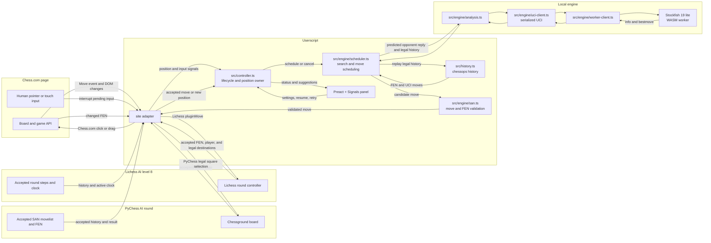

# Super Chess Bot

A GPL-3.0-or-later browser userscript with local Stockfish analysis and confirmed move input on Chess.com computer games, PyChess Fairy-Stockfish games, and Lichess Play against computer at level 8. Engine strength and bullet performance depend on the device and move budget; this project does not claim a measured Elo.

## Architecture



- **Engine:** pinned Stockfish 19 lite single-threaded WASM. The worker prewarms when the panel mounts, while automation stays disabled, so download and WASM compilation happen before the first game move. One worker survives normal searches and cancellation, preserving its transposition table. The userscript manager downloads pinned JS/WASM resources from unpkg; keep this host because jsDelivr rejects the full 205 MB npm package even for its small lite files. Search is local after initialization. No main-thread search fallback.
- **Site adapters:** exact-host adapters provide the current accepted FEN, player color, orientation, phase, clock, history, and supported controls. Chess.com keeps its private game API and click/drag input inside its adapter. PyChess reads Chessground state plus the accepted SAN movelist, and uses legal `selectSquare` user moves. Lichess is limited to standard Play against computer games at AI level 8. Its adapter captures the round controller during page initialization and uses `pluginMove`; it does not call a Lichess API or write directly to the socket. This hook depends on private page internals and may need updates after Lichess frontend changes.
- **Controller:** waits for engine readiness, owns a stable game/board identity and search revision, rejects obsolete results, and stops pending work when disabled. Replay and finished positions suspend analysis. Trusted board interaction pauses automation; a changed position resumes automatically, while an unchanged position offers Resume.
- **Timing:** the configured move budget reserves input time once. PyChess and Lichess read the active player's clock from their round state; Chess.com keeps its current clock handling. Lichess move submission goes through the round controller's normal clock stop and move-send path. There is no second post-search thinking delay. A separate bounded confirmation checks the accepted position at the expected ply. Browser scheduling and engine stop latency can exceed the requested budget.
- **Recovery:** trusted human board input cancels pending automation and pauses the bot. A changed position resumes analysis automatically; when the position stays the same, the panel offers Resume. Engine and unconfirmed-input failures offer Retry.
- **History:** chessops reconstructs the selected SAN line into UCI history for repetition-aware search. Incomplete history falls back to the current FEN; repetition before that FEN cannot then be inferred.
- **Ponder:** enabled by default for new settings. The chosen move's principal variation predicts one opponent reply, then Stockfish searches the resulting position with UCI `go ponder` during the opponent's turn. An exact FEN and history match promotes that search; a completed ponder result is also reused only when FEN, history, and depth all match. A miss is stopped and drained before a fresh search. At depth 12 or higher the current best move is returned immediately; shallower searches get the normal foreground budget after `ponderhit`. This spends CPU while the opponent thinks and can use more battery. The panel toggle can disable it. Pondering analyzes a predicted reply; it does not queue a premove.
- **UI:** Preact + Signals inside Shadow DOM with focused Hallmark workbench styles. The panel is draggable, logs are capped at 100 entries, stored settings are validated with Valibot (~1.5 kB), and keyboard hotkeys (`Ctrl+B` minimize, `E` toggle automation, `R` retry) enable rapid bullet play. The bot starts disabled each time.

## Install and use

1. Install Tampermonkey or Violentmonkey in Chromium.
2. Build and install `dist/bundle.user.js`. The userscript manager also fetches the two version-pinned engine resources.
3. Choose a supported game: a Chess.com computer game, PyChess **Play with AI**, or Lichess **Play against computer** at level 8.
4. On PyChess, keep **CHESS**, Chess960 off, Random-Mover off, and real-time play. The level range is 0–8; the acceptance target is Fairy-Stockfish level 7. For 1+0, set the minutes slider to index **4** (one minute), increment to 0, and select **White** by its title. The Puzzle of the day page is not an AI game.
5. Wait for the panel and Stockfish to report `Ready`, then enable the bot. It starts disabled on each page load. Choose auto move or analysis-only mode.
6. Start at a 100 ms budget, then tune against measured strength and latency on your device. The default depth cap is 30, letting the time budget normally end a fresh search; achieved depth varies. A matching ponder search can make the response immediate after it reaches depth 12.

For Lichess in Violentmonkey, enable **Settings → Advanced → Synchronous `<page>` mode** and reload Lichess after installing or updating the script. The controller bridge must run in the page context before Lichess initializes its round.

PyChess support is limited to a live, owned 8×8 chess round where the signed-in or anonymous player identity matches White or Black and the opponent is Fairy-Stockfish. The adapter checks the game URL and id, player membership, variant, Chess960 setting, real-time mode, AI level, accepted six-field FEN, and legal SAN history. It submits moves through the board's legal square-selection path and waits for the server-confirmed FEN at the bot move's ply. When browsing an older move, input is suspended until the live position returns. A trusted board action pauses the bot and shows Resume when the accepted position has not changed.

Lichess support is limited to a live, standard chess game from **Play against computer** with the maximum AI level 8. The adapter verifies the AI game source, opponent level, player round, accepted FEN and SAN history, side to move, and legal destinations. It sends ordinary moves and explicit promotion roles through the round controller and waits for the accepted position. The active clock is read from the same round controller; the site's move path stops it and sends the move. No API integration is used.

On PyChess the panel explains the legal square-selection transport; on Lichess it identifies the game-controller transport. Both hide the Chess.com gesture and rematch controls. Those stored Chess.com preferences are left as saved, so using the same userscript on Chess.com keeps its selected input method and rematch setting.

Click input is the default. Drag input exists for boards that reject click input; promotion waits for the site's chooser. An unconfirmed move is not retried repeatedly against the same position. Change settings or advance the position to retry deliberately.

## Development

```sh
bun install --frozen-lockfile
bun run check
```

`bun run check` runs Biome, strict TypeScript, Knip, Vitest, and the production build. Run one step with `bun run test`, `bun run typecheck`, `bun run lint`, `bun run knip`, or `bun run build`. Biome and Knip are development tools and are not included in the userscript. Stockfish is loaded as a userscript resource, so Knip's configuration accounts for that external loading.

## Browser verification

Use `agent-browser` with a dedicated Chromium session and the production bundle installed through a userscript manager. Test board orientation, promotion, enable/disable during search, game reset, human interruption and recovery, and the position event path. Test Lichess only at AI level 8. The controller hook is version-sensitive; record when a live player route is unavailable.

The full game verified through an installed Violentmonkey manager, including the result, move list, and recording, is documented in [browser-verification.md](docs/browser-verification.md).

The latest 1+0 minimum-budget samples, including two wins against the displayed 3200 Maximum bot, are also recorded there. A later warmed 2900 run used 36.3 seconds on our clock, compared with 13.4 seconds in an earlier run, so sub-5-second whole-game timing is not established. For strength checks, record the opponent's displayed rating, result, time control, bot move budget, plies, and our clock before and after the game. Report initialization, warmed search, and move confirmation separately. These games are observations, not a calibrated bot Elo; repeat games before making a reliability claim.

Chess.com premoves were manually verified against a computer opponent in a no-timer game. The platform executed a queued move after the bot's reply. Automatic premoves remain off: Chess.com says each one costs 0.1 seconds and plays regardless of the opponent's move, so they can create blunders and do not guarantee a lower total clock cost. See the measured test and policy notes in [browser-verification.md](docs/browser-verification.md).

## License

GPL-3.0-or-later. Stockfish's bundled engine remains GPL-3.0; its upstream source and license are available at https://github.com/nmrugg/stockfish.js. See `LICENSE`.
