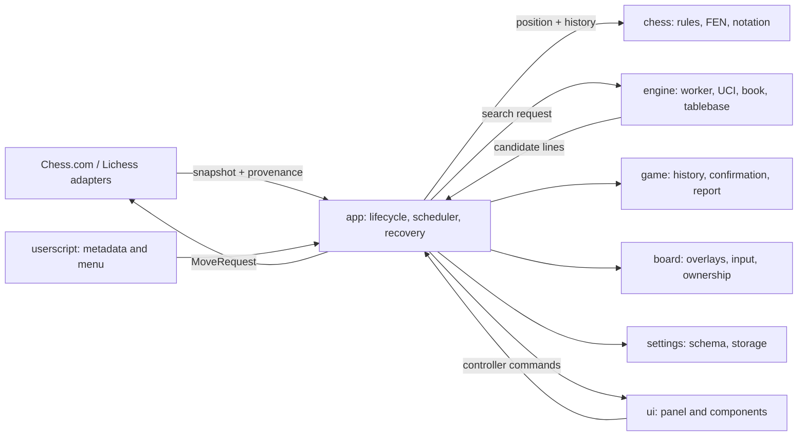

# Architecture

The bot keeps browser ownership at the edge: the app coordinates site adapters and commands, the engine returns candidate moves, and adapters submit them through each site's own controller path. Automation is off by default.

## Module boundaries

The source is organized around these responsibility groups; exact filenames can evolve while these boundaries stay stable.

| Area | Owns |
| --- | --- |
| `app/` | Enable/disable lifecycle, snapshot identity, search-to-move coordination, report eligibility, interruption and bounded recovery |
| `chess/` | Browser-independent positions, rules and variant identity, history replay and notation |
| `sites/` | Host selection, private controller bridges, snapshots, move submission, and the provenance of observed positions |
| `engine/` | Engine resources, the serialized UCI worker, search, opening book, tablebase lookup, candidate selection and timing |
| `game/` | Accepted/local move observations, move records, elapsed-time estimates, PGN and post-game analysis |
| `board/` | Board overlays, trusted-input revision and ownership tracking for injected nodes |
| `settings/` | Validation, defaults and persistence |
| `ui/` | Panel presentation and user actions dispatched back through the app |
| `userscript/` and `shared/` | Userscript metadata/menu and small browser-independent helpers |

The engine must not import UI code or submit moves. Site-specific internals stay inside their adapter and bridge. The engine is orthodox Stockfish, supporting standard chess and Chess960; non-standard variants are unsupported.

## Search and move flow

The selected adapter produces a snapshot with game identity, phase, position, history, clock readings and a `confirmationSource`. The app validates that the snapshot still belongs to the same live position before using search output. The engine uses one owned worker at a time and returns candidate lines. When automation is enabled, the app sends one move through the adapter and waits for an observation at the requested ply.

For standard chess positions with up to seven pieces, the app races a Syzygy request with local engine search. The tablebase cache holds at most 256 results keyed by full FEN. DTZ and DTM remain separate; DTZ is not converted to a mate score. The first usable result wins, and local search does not wait for a tablebase grace interval after it finishes.

Chess.com controller FEN and SAN history update optimistically inside the local controller. Its adapter therefore labels a matching observation `controller-local`; this proves local application only. Lichess positions come from validated site-owned round steps and are labeled `site-accepted`. Neither source is documented as an independent network/server acknowledgement.

## Game records and reports

The history tracker preserves the clock baseline for the current turn across ticking snapshots. If an adapter supplies both clock readings and a known increment, elapsed time uses the clock delta plus increment. When increment is unknown, it falls back to wall time; the displayed and exported durations are estimates, not authoritative telemetry.

Reports are local estimates and run only when the adapter reports a finished game. Viewing an ongoing game in replay remains ineligible. Manual cancellation suppresses automatic regeneration until explicit generation or a new game. The default report search uses depth 18 and 350 ms per position; the UI allows depth 10 through 26. The app cancels the report on lifecycle changes so its UCI work does not compete with live move search.

Automatic recovery is scoped to a session and position, with at most two retries. Automatic retry is permitted only before a transport dispatch attempt. If submission was initiated and the expected observation does not arrive, the app leaves recovery to explicit user action rather than automatically repeating that move.

## UI encapsulation

The panel is mounted in a closed Shadow DOM to isolate its markup and styles from page selectors. Ghost Mode hides the panel and board overlays for streaming. Neither mechanism guarantees invisibility or protection from site detection.

## Madman selection

`engine/madman.ts` owns legal attacking proposals, geometric/PV pressure preferences and the estimated centipawn risk envelope. `engine/madman-search.ts` owns bounded restricted discovery and optional legal capture probes through the existing engine service. The scheduler owns session cancellation and seeds the selected attack continuation only after a submitted move is observed. `engine/madman-premove.ts` owns context-validated prediction/planned/seed/fast/full cached replies and observed-offer capture hints and serialized opponent-clock branch preparation. Evaluated Madman moves use the same 120 cp ceiling every turn, without cooldown. Madman supersedes Elo sampling and normal unchecked book/recapture dispatch while enabled; exact tablebase outcomes remain authoritative. Search scores keep their original meaning and are separate from style points.
